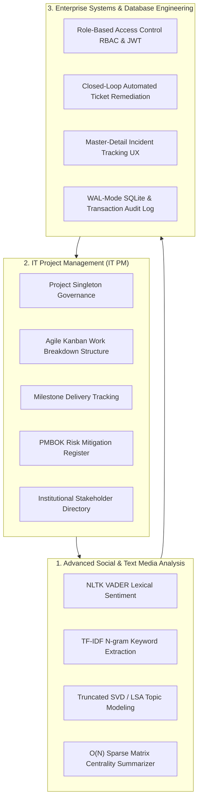
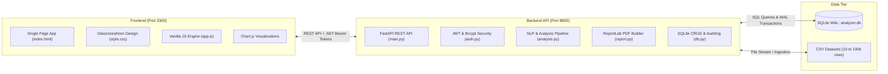

# College Event Feedback Analyzer (Event Insight)
### Comprehensive Project Explanation & Architecture Guide

---

## 1. What is this Project? (High-Level Overview)

**College Event Feedback Analyzer (Event Insight)** is an end-to-end, full-stack enterprise web application designed to collect, analyze, and act upon attendee feedback from college events (such as tech fests, cultural nights, conferences, workshops, and sports meets).

Instead of treating feedback as static spreadsheets that get filed away and forgotten, this project introduces a **Closed-Loop Feedback Remediation Cycle**:
1. **Analyze**: Ingest raw attendee feedback from CSV files (from 10 rows up to 100,000 rows).
2. **Understand**: Run offline Natural Language Processing (NLP) to detect sentiment, extract top keywords, group discussions into topics, and generate concise executive summaries.
3. **Govern & Plan**: Track the event rollout using formal IT Project Management (Kanban tasks, milestones, risk registers, and stakeholder directories).
4. **Remediate**: Automatically turn negative feedback comments into prioritized enterprise support tickets that can be assigned, tracked, and marked as resolved.
5. **Audit**: Introspect live database transactions and export publication-ready institutional PDF audit reports.

---

## 2. The 3 Core Academic Domains Integrated

Most academic projects are simple "mini-demos" that only do one thing (e.g. just a sentiment script or just a basic login form). This project solves that problem by integrating **three foundational Computer Science / IT subjects** into one unified, production-ready system:



### Domain 1: Advanced Social & Text Media Analysis
- **100% Offline & Local**: Zero third-party cloud APIs (no OpenAI, no Google Cloud keys, no recurring costs). Runs on standard commodity hardware.
- **VADER Sentiment Analysis**: Computes compound polarity scores from `-1.0` (extremely negative) to `+1.0` (extremely positive), categorizing responses into Positive, Neutral, or Negative.
- **TF-IDF Vectorization**: Identifies statistically significant unigrams and bigrams that characterize what students are talking about.
- **Latent Semantic Analysis (Truncated SVD)**: Discovers hidden topics and thematic keyword clusters across thousands of responses.
- **Algorithmic Extractive Summarizer**: Employs an $O(N)$ sparse matrix vector dot-product combined with sentiment intensity to pull the most representative quotes without eating system memory.
- **ReportLab PDF Export**: Creates executive PDF audits containing charts, summaries, and issue breakdowns for college deans and organizers.

### Domain 2: IT Project Management (IT PM)
- **Project Governance**: A centralized entity tracking event campaign budget, launch dates, and progress.
- **Agile Kanban Board**: Work Breakdown Structure (WBS) tracking tasks across 4 workflow states (`To Do`, `In Progress`, `Review`, `Completed`) with priorities and assignees.
- **Milestone Tracker**: Ensures critical deadlines (survey deployment, data audit, stakeholder presentations) are met on time.
- **PMBOK-Compliant Risk Register**: Tracks potential operational hazards (server overload, low turnout, food shortages) along with likelihood, impact, and formal mitigation plans.
- **Stakeholder Directory**: Keeps track of department heads, faculty sponsors, and student leads.

### Domain 3: Enterprise Systems & Database Engineering
- **Identity & Access Management (IAM)**: Token-based authentication using **JSON Web Tokens (JWT)** and **bcrypt** password hashing.
- **Role-Based Access Control (RBAC)**:
  - `admin`: Can create/edit/delete tasks, risks, milestones, tickets, and user accounts.
  - `viewer`: Read-only access for auditors and reviewers.
- **Automated Ticket Pipeline**: Every negative feedback comment automatically becomes an enterprise remediation ticket assigned to categories like *Logistics*, *Audio/Visual*, *Catering*, *Hospitality*, or *Registration*.
- **Database Architecture**: SQLite in WAL (Write-Ahead Logging) mode with foreign keys enabled, indexed queries, and real-time transaction auditing.

---

## 3. System Architecture & Tech Stack



| Layer | Technology | Key Responsibilities |
|---|---|---|
| **Frontend** | HTML5, Vanilla JavaScript, CSS3 | Glassmorphism responsive UI, Chart.js interactive charts, drag-and-drop CSV upload, tabbed navigation, live database introspector. |
| **Backend Framework** | Python 3.9+, FastAPI, Uvicorn | High-performance asynchronous REST API, OpenAPI/Swagger auto-documentation, CORS handling, route authorization guards. |
| **NLP Engine** | NLTK (VADER), Scikit-Learn (TF-IDF, SVD), WordCloud | Local text preprocessing, lexical polarity scoring, matrix dimensionality reduction, extractive summarization. |
| **Database** | SQLite 3 (WAL Mode) | Relational persistence (`analyzer.db`), zero-config serverless architecture, foreign keys, transaction audit logs. |
| **PDF Reporting** | ReportLab | Programmatic vector PDF generation with styling, tabular summaries, and metric scorecards. |

---

## 4. End-to-End Workflow: How the System Works Step-by-Step

### Step 1: Pre-Event Planning (IT PM Module)
1. Event organizers log into the dashboard using the default administrator credentials (`admin` / `Admin@Event123`).
2. They access the **Project Management** tab to define the event project scope, set budget constraints, and configure the target completion date.
3. Organizers populate the **Kanban Board** with pre-event tasks (e.g. "Draft survey questions", "Set up Wi-Fi in auditorium", "Arrange catering").
4. Potential failure points are recorded in the **Risk Register** (e.g. "Risk: Microphones cut out; Likelihood: Medium; Impact: High; Mitigation: Keep wired backups ready").

### Step 2: Feedback Collection & CSV Ingestion
1. After the event finishes, attendee responses collected via Google Forms, Microsoft Forms, or paper surveys are exported into a `.csv` file.
2. The user navigates to the **Upload & Analyze** tab and drops the CSV file into the upload zone.
3. The backend **Intelligent Column Classifier** inspects the CSV headers and sample values:
   - Identifies rating columns (1-5 or 1-10 numerical scales).
   - Identifies free-form comment/feedback columns.
   - Identifies categorical/demographic fields (Year, Department, Role).
   - Automatically filters out serial sequence IDs (e.g. `Response_0001`).

### Step 3: NLP Analysis Engine Execution
Within milliseconds (or a few seconds for 100,000 rows):
- **Sentiment Scores**: Every text response is evaluated by VADER and assigned a compound score from -1.0 to +1.0.
- **Keyword Extraction**: TF-IDF calculates term weights across all responses to extract the top 25 high-frequency, high-importance keywords.
- **Topic Modeling**: Truncated SVD groups related comments into 4 core thematic topics.
- **Extractive Summary**: The $O(N)$ sparse dot-product summarizer ranks sentences by representativeness and sentiment intensity, generating an executive overview with representative quotes.
- **Word Cloud**: Generates an in-memory word cloud image encoded in Base64 for instant display.

### Step 4: Closed-Loop Enterprise Remediation
- The system automatically filters out all responses flagged with negative sentiment (`compound <= -0.05`).
- Each negative review is converted into a ticket in the `issues` table.
- The system assigns an enterprise category (Logistics, Catering, Audio/Visual, Hospitality, Registration) and priority (Low, Medium, High, Critical) based on keyword heuristics.
- Event managers can open the **Enterprise Issues** tab, assign tickets to coordinators, leave remediation comments, and change status from `new` to `in-progress` to `resolved`.

### Step 5: Auditing & PDF Reporting
- Organizers click **Download PDF Report** to instantly generate an audit report for college management.
- The **Database Introspection & Logs** tab allows examiners or IT auditors to inspect the raw SQLite tables, verify referential integrity, and review real-time transaction timestamps.

---

## 5. Algorithmic Highlights (Why it Impresses Evaluators)

### 1. $O(N)$ Sparse Matrix Extractive Summarization
- **The Problem**: Standard graph-based text summarizers (like TextRank) build a dense $N \times N$ similarity matrix. For $N = 12,000$ responses, a dense matrix requires over **1.15 GB of RAM** and runs in $O(N^2)$ time, causing browser crashes or server out-of-memory errors.
- **The Solution in this Project**:
  We utilize a mathematical identity:
  $$\left(M \cdot M^T\right) \cdot \mathbf{1} = M \cdot \left(M^T \cdot \mathbf{1}\right)$$
  Instead of computing the dense $N \times N$ matrix $M \cdot M^T$, we first compute the column sum $M^T \cdot \mathbf{1}$ (a small vector of dimension $1 \times \text{features}$), and then multiply $M$ by this vector.
  This reduces time complexity from $O(N^2)$ to **$O(N)$**, processing 10,000+ responses in under 200 milliseconds with minimal memory!

### 2. Zero-Cloud Local Inference
- Many student projects rely on paid third-party APIs (like OpenAI GPT-4 or Claude). If an internet connection drops or API credits run out during an exam or demo, the project breaks.
- Event Insight runs **100% locally** using NLTK and Scikit-Learn. It works completely offline on any laptop.

### 3. Resilient Column Classification
- The CSV ingestion does not enforce rigid, hardcoded column names like `feedback` or `rating`.
- It analyzes standard deviations, data types, string length ratios, and lexical keywords (`"satisfaction"`, `"rate"`, `"comment"`, `"experience"`) to automatically detect data shapes dynamically.

---

## 6. Directory Structure & File Roles

```
college-event-feedback-analyzer/
├── backend/
│   ├── app/
│   │   ├── main.py              # FastAPI endpoints, CORS, routers, and request validation
│   │   ├── analysis.py          # Local NLP: VADER, TF-IDF, LSA Topics, O(N) summarizer
│   │   ├── auth.py              # JWT authentication, bcrypt hashing, RBAC dependencies
│   │   ├── db.py                # SQLite schema, migrations, transaction logging, CRUD
│   │   └── report.py            # ReportLab institutional PDF report generation
│   ├── requirements.txt         # Python dependencies (fastapi, uvicorn, nltk, scikit-learn, etc.)
│   └── analyzer.db              # SQLite relational database (WAL mode, auto-seeded)
├── frontend/
│   ├── index.html               # Single-page dashboard containing all 3 domain views
│   ├── css/
│   │   └── style.css            # Custom CSS design system (Dark/Light themes, Kanban, Tables)
│   ├── js/
│   │   └── app.js               # State store, Chart.js integrations, API client, UI bindings
│   └── assets/                  # SVG icons and logos
├── scripts/
│   ├── generate_100k_data.py    # Generates a realistic 100,000-row synthetic benchmark CSV
│   ├── generate_500_negative_data.py # Generates 500 mostly negative reviews for triage testing
│   └── verify_system.py         # Automated end-to-end integration test suite
├── run.bat                      # One-click Windows launcher (starts backend + frontend)
├── sample_responses.csv         # 10-row starter test dataset
├── sample_100_responses.csv     # 100-row comprehensive test dataset
├── sample_500_negative_responses.csv # 500-row incident review dataset
├── annual_college_event_feedback_100000.csv # 100k-row stress-test dataset
├── README.md                    # Repository documentation
└── PROJECT_DOCUMENTATION.md     # In-depth academic & technical reference
```

---

## 7. How to Run the Project Locally

### Prerequisites
- Python 3.9 or higher installed and added to your system `PATH`.
- Google Chrome, Firefox, or Microsoft Edge.

### Option A: One-Click Launcher (Windows)
Double-click `run.bat` in the project folder. This script automatically:
1. Verifies your Python environment.
2. Starts the **FastAPI backend** on `http://localhost:8800`.
3. Starts the **Frontend server** on `http://localhost:3300`.
4. Launches your default web browser directly to the dashboard.

### Option B: Manual Terminal Execution
If you prefer running via command prompt or terminal:

**1. Launch Backend:**
```bash
cd backend
python -m uvicorn app.main:app --reload --host 127.0.0.1 --port 8800
```
*(Backend Swagger docs will be accessible at `http://127.0.0.1:8800/docs`)*

**2. Launch Frontend:**
```bash
cd frontend
python -m http.server 3300 --bind 127.0.0.1
```
*(Open `http://localhost:3300` in your browser)*

### Default Login Accounts
| Role | Username | Password | Permissions |
|---|---|---|---|
| **Administrator** | `admin` | `Admin@Event123` | Full Access (Create/Update/Delete tasks, risks, tickets, users) |
| **Viewer / Auditor** | `viewer` | `Viewer@Event123` | Read-only Access (Can view dashboards, introspect DB, download PDFs) |

---

## 8. Common Viva / Project Presentation Questions & Answers

### Q1: What makes this project different from a standard sentiment analysis project?
> **Answer**: Most sentiment analysis projects stop at generating a bar chart of positive vs. negative reviews. This project implements a complete **Closed-Loop Remediation Cycle**: it detects negative feedback, extracts the complaint text, automatically categorizes it (e.g. Catering, Audio/Visual), assigns priority, and creates an actionable enterprise ticket. Furthermore, it embeds this feedback lifecycle into formal **IT Project Management** (Kanban boards, WBS, PMBOK risk mitigation registers).

### Q2: Why did you use SQLite instead of PostgreSQL or MongoDB?
> **Answer**: 
> 1. **Academic Self-Containment**: SQLite is a serverless, zero-configuration engine stored in a single file (`backend/analyzer.db`). Any evaluator can clone the repository and run it immediately without needing to configure Docker containers or database credentials.
> 2. **Enterprise Concurrency**: We enabled **WAL (Write-Ahead Logging)** mode and foreign key constraints, allowing simultaneous reads while write transactions are occurring, which handles high-concurrency loads reliably.

### Q3: How do you handle large datasets like 100,000 feedback responses without running out of memory?
> **Answer**: Traditional extractive summarization uses similarity matrices of size $N \times N$, which explodes to gigabytes of RAM for large datasets. We implemented an optimized **$O(N)$ sparse vector dot-product**:
> $(M \cdot M^T) \cdot \mathbf{1} = M \cdot (M^T \cdot \mathbf{1})$.
> This computes sentence centrality in linear time with minimal memory overhead.

### Q4: Which algorithm is used for topic extraction and why?
> **Answer**: We use **Latent Semantic Analysis (Truncated SVD)** over TF-IDF matrices. Truncated SVD performs low-rank matrix approximation, uncovering latent semantic correlations between terms and grouping them into interpretable topics quickly without requiring GPU acceleration or deep learning models.

### Q5: How is user security and Role-Based Access Control (RBAC) handled?
> **Answer**: Passwords are never stored in plain text; they are hashed using **bcrypt** with randomized salts. Authentication uses stateless **JSON Web Tokens (JWT)** with HMAC-SHA256 signatures. Routes on the backend enforce role dependencies (e.g. `require_admin`), preventing viewers from modifying project tasks or resolving issues.
